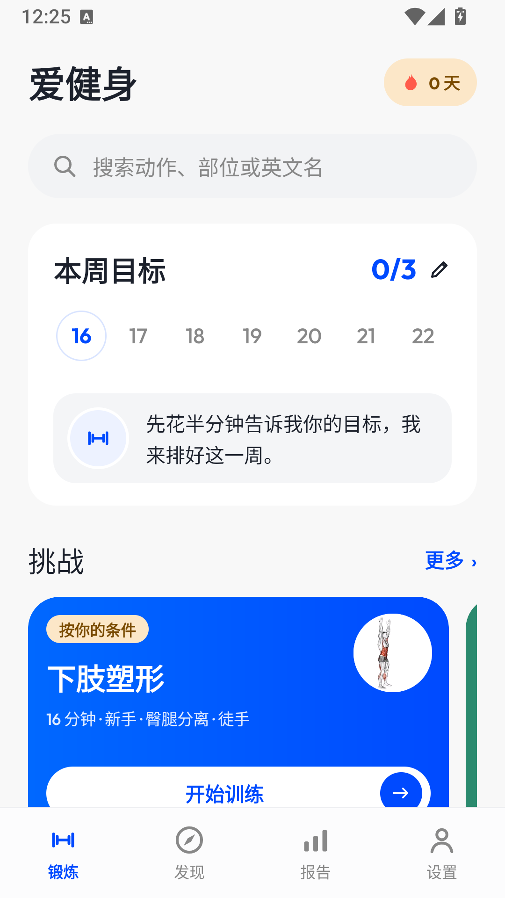
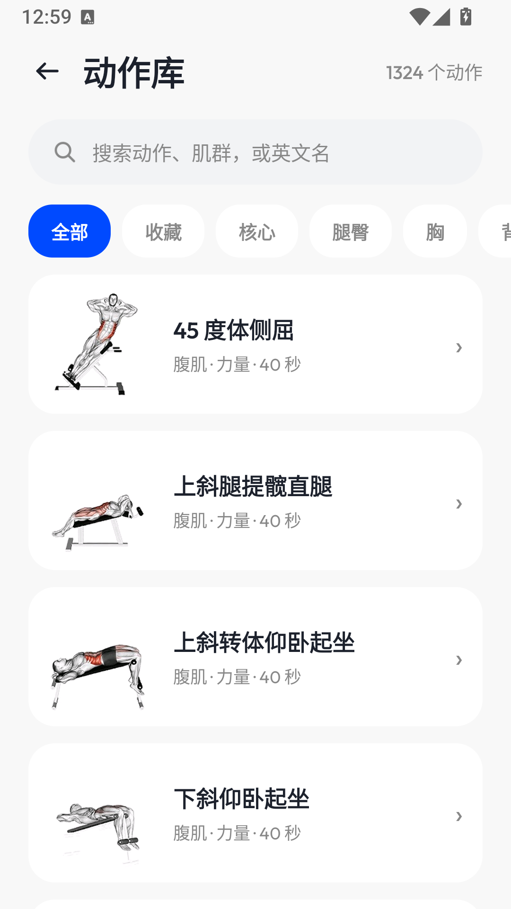

# 私人健身教练（YuanLian）

一个不依赖任何境外服务的本地训练 App。纯 Java + XML，46 个类约 14 700 行，
运行时零第三方依赖，完整 APK 约 **168 MB**（其中约 140 MB 是 1324 段
640px 循环演示、34 MB 是 960px 静态图），素材全部打进安装包，装完即用、不下载任何资源。

没有云端账号，也不访问公网。用到的两个「对外」能力都是本地闭环：蓝牙直连体脂秤、
同一 Wi-Fi 下手机与手机点对点同步。

| | |
|---|---|
| 版本 | 1.7（versionCode 7） |
| 包名 | `com.yuanlian.app` |
| 系统要求 | Android 8.0+（minSdk 26），targetSdk 36 |
| 动作库 | 1324 个动作 · 10 个部位 · 力量 / 拉伸 / 有氧 |
| 安装包 | 168 MB，单 APK，无原生库，任何机型通用 |

<p>





</p>

全部 14 张真机截图（含体重、体脂秤、手机同步）见 **[screens.html](screens.html)**，
用浏览器直接打开即可。

## 安装

直接安装，无需任何额外资源包，首次启动也不联网。

```bash
adb install -r app/build/outputs/apk/debug/app-debug.apk
```

- 包内已含 `assets/img` 1324 张静态图、`assets/anim` 1324 段循环动画、
  字体与动作数据（`exercises.json` 659 KB、`boxes.json` 40 KB），
  不需要另外拷素材到 `/sdcard`。
- 当前是 **debug 签名**（`CN=Android Debug`），可正常安装、分享、分发；
  若需上架应用市场，需另配 release keystore 重新签名。
- 覆盖安装不会丢数据（全部数据在 `SharedPreferences` 内）。

## 功能

- **首页**：定制计划卡（未生成时是向导入口）、今日训练大卡、连续天数 / 本周完成 /
  累计分钟、七天安排（52dp 缩略图，训练日显示动作数 × 轮数 × 分钟，恢复日显示拉伸数）、
  上次没练完时显示「继续上次训练」入口
- **动作库**：1324 个动作，10 个部位筛选，中英文名与肌群均可搜索，可只看收藏
- **详情**：白底无缝的循环演示、部位 / 目标肌群 / 类型 / 器械标签、分步中文要领、
  星标收藏、底部固定「练这个动作」
- **训练**：第 r/R 轮 · 第 x/N 个动作的进度标签（休息时改写为「第 r/R 轮 · 组间休息」，
  不会把休息当成一个动作去计数）、按计划时长设置动作与休息秒数、卡片描边倒计时
  （按绝对时间计时，不会越练越慢）、暂停 / 跳过、休息时 +15 秒 / 跳过休息、
  完成自动记录；训练中可换动作、看动作要领、收藏动作、控制音乐，屏幕保持常亮
- **结果页**：完成时长 / 消耗 / 动作数、本周进度、感受记录、当次体重与 BMI、
  顺手设提醒，可一键再做一次
- **训练设置**：预备倒计时（关 / 3 / 5 / 10 秒）、休息时长（跟随计划或 10–60 秒）、
  提示音、振动、语音口令（系统 TTS）、背景音乐（从本机选择，复制进应用内，
  不依赖外部文件也不上传；抢到音频焦点才播，来电或别的 App 出声会自动让路）
- **报告**：运动 / 消耗 / 分钟总览、本周柱状图、连续天数与日历详情、每日训练明细
  （长按可删除，当天与累计分钟一起扣回）、体重曲线与 BMI、公斤 / 斤单位切换、手动补记分钟数
- **提醒**：每天定时本地通知，可先发测试通知；通知权限在页面里直接引导授权
- **定制**：目标 / 水平 / 频率 / 时长 / 器械 / 重点，生成并持久化一周计划
- **体重与身体成分**：当前体重卡、身高 / 年龄 / 性别、4 宫格主指标 + 14 项细分指标、
  测量记录；可蓝牙称重、手动记录，或从另一台手机同步
- **连接体脂秤**：扫描 → 连接 → 实时读数 → 稳定后自动保存；没有阻抗时只记体重与 BMI
- **手机间同步**：开 / 关本机同步服务、填对方地址、推送 / 拉取，页面显示上次同步结果
- 数据全部存在本机

### 权限

| 权限 | 用途 |
|---|---|
| `BLUETOOTH_SCAN`（`neverForLocation`）/ `BLUETOOTH_CONNECT` | Android 12+ 扫描并连接体脂秤 |
| `BLUETOOTH` / `BLUETOOTH_ADMIN` | Android 11 及以下的对应权限 |
| `ACCESS_FINE_LOCATION`（`maxSdkVersion=30`） | Android 11 及以下扫描 BLE 的系统要求 |
| `INTERNET` | 只用于手机间同步的局域网 HTTP，`networkSecurityConfig` 放行明文 |
| `POST_NOTIFICATIONS` | 训练提醒的本地通知 |

不开同步服务、不填对方地址时，应用不会发起任何网络请求；也没有任何域名或云端地址硬编码。

## 动作演示：矢量化重制

数据集提供的缩略图与 GIF 原生只有 **180×180**。旧版 320/360 输出是裁边后的 LANCZOS
插值放大，近看会有明显软边。1.5 版把每一帧重新制作为：

1. 按所有帧的并集包围盒裁掉白边，留 8% 边距、补成正方形
2. 静态图先做 3×、动画帧先做 2× LANCZOS 预放大，再交给 vtracer 描成 SVG
3. 用 resvg 渲染到静态图 **960×960**、动图 **640×640**；线条和色块来自矢量路径，
   放大看边缘不再有插值糊边
4. 960 静图会放大描摹分层产生的色带，所以用 `layer_difference=1` 的高保真参数，
   渲染后加 0.5px 柔化；640 动画帧保留更省时的参数，运动中也看不出色带
5. 动图保留原 GIF 的逐帧时长（首尾各 1s + 每帧 100ms）与循环标记；
   WebP 以 q84 / q58 编码，`noCompress` 保证 `ImageDecoder` 可随机访问

矢量化不是凭空补细节：180px 源图没有的高频信息不会出现，它只是把插值糊边换成干净
路径并保留原笔触。要真正 4K 级细节，需要更高分辨率的原片。

渲染（`PhotoView.java`）：

- API 28+ 走 `ImageDecoder` + `AnimatedImageDrawable`，无限循环；API 26/27 自动回退静态 WebP
- 素材本身是纯白底，卡片、弹窗、列表也全是纯白：去掉描边与渐变，图像和容器没有分界线，
  这就是「背景融合」的来源；训练页再套一层白色大卡，用描边进度圈住画面
- 列表用静态图并按视图大小采样解码；动图只在详情弹窗和训练页播放，滚动与内存都稳
- 训练页把倒计时进度画成**卡片描边**（`DashPathEffect` 沿圆角矩形路径走一圈），
  计时结束正好合口

### 主体框归一化（`assets/boxes.json`）

数据集里每张插画的人物占比并不一致：有的顶满画布，有的四周留大片白。直接
`fitCenter` 会出现「这一张人头很大、下一张缩成小图」的跳动。

`tools/build_boxes.py` 离线把 1324 组素材逐张扫一遍：静图取一次、动图抽最多 6 帧，
求「非白像素」包围盒的**并集**（只算静图会让动图的手脚跑出框），加 3.5% 内边距、
边长下限 0.32 防止过小的局部特写被放大到失真，最后归一化写进 `boxes.json`（40 KB）。
运行时 `PhotoView.fitContent()` 按框 fitCenter，同一套缩放规则对所有图生效，
所以列表缩略图、详情弹窗和训练页里的人物大小是一致的。

## 数据

**1324 个动作**（数据集全量，含器械），力量 1204 / 拉伸 72 / 有氧 48。
10 个部位：手臂 292 / 腿臀 227 / 背 203 / 核心 169 / 胸 163 / 肩 143 /
小腿 59 / 小臂 37 / 有氧 29 / 颈部 2。

其中 1095 条标注了器械（哑铃 294 / 绳索 167 / 杠铃 154 / 器械 81 / 弹力带 54 …），
229 条纯徒手。列表和详情直接标出器械（`哑铃`、`单杠`…），排每日计划时优先挑
真正不用器械的那一批，所以「打开就能练」的体验不受影响。

英文名按最长短语优先翻译成中文（`45°`、`v.2`、`二式/三式` 去重后加后缀），
分步要领直接用数据集自带的中文说明，没有机翻。

## 定制计划

首页的「按你的条件生成计划」让用户选 6 组条件，30 秒排好一周：

| 条件 | 选项 | 影响 |
|---|---|---|
| 目标 | 减脂 / 增肌 / 塑形 / 放松 | 动作类型、主题模板、组间休息 |
| 水平 | 新手 / 进阶 / 高手 | 每个动作 30 / 40 / 50 秒 |
| 频率 | 每周 2–6 练 | 训练日分散，其余日子是 5 个拉伸的恢复日 |
| 时长 | 10 / 15 / 20 / 30 分钟 | 换算成动作段数，再拆成 1–8 轮 |
| 器械 | 徒手 / 哑铃·弹力带 / 单杠·长凳 / 健身房 | 动作池过滤，徒手始终保留，可多选 |
| 重点 | 全身 / 核心 / 腿臀 / 胸背 / 肩臂 / 有氧 | 部位过滤，可多选 |

生成逻辑在 `Data.weekPlan`：按目标选主题模板（例如减脂的全身燃脂、间歇有氧），
按「时长 ÷ (动作秒数 + 休息秒数)」算动作段数，再拆成轮次与每轮个数；
按主题部位从动作池里无重复抽取，增肌且选了器械时优先排器械动作。
条件不变的一个自然周内结果稳定，换周或改条件才重新排列。计划只存本地
SharedPreferences，不需要账号、也不联公网。

## 体重与体成分

### 蓝牙直连体脂秤

秤是 AntAF 那套私有 GATT 协议，没有标准蓝牙体重服务，所以协议逐行移植在
`BleScale`（对应原来 Python 的 `scale_reader.py`）：

| 项 | 值 |
|---|---|
| 服务 / 写 / 通知 | `0xFFB0` / `0xFFB1` / `0xFFB2` |
| 配对 | 不需要，直接连 |
| 帧长 | 20 字节，包头 `0xAC`，包类型在 `data[18]` |
| `0xD0` 资料包 | 下发身高 / 年龄 / 性别，功能位 `0x03` 打开阻抗；15 秒未收到回包会重发 |
| `0xD5` 体重包 | 32 位大端，低 18 位是克数，`bit18-20` 是精度档位，`bit31` 是稳定位 |
| `0xD6` 阻抗包 | 同上编码，值即阻抗（欧姆） |

精度档位要靠 `division` 反推（5 档，各有取整 / 取偶规则），另外补一条「小数 ≥ 0.9
进位」的修正，否则 74.6 会显示成 74.5。稳定位落下后才落库，避免来回跳的中间值被记成
两条记录；去重窗口 30 秒，同一段称重过程只写一条。

秤只给体重和阻抗，18 项体成分在 `BodyComp` 里按 BIA 公式算：瘦体重起点 + 分龄体脂阈值
+ 内脏脂肪经验式 + 骨量 / 肌肉量分档 + Mifflin-St Jeor 基础代谢。公式、阈值与取整
规则与 AntAF 的 `body_composition.py` 逐项对齐，已用同一组输入对拍验证（75 kg / 175 cm
/ 30 岁男 → BMI 24.49、体脂 20.15%、肌肉 57.37 kg、水分 54.77%、骨量 2.96、
BMR 1699、去脂 59.88，两版完全一致）。

真机实测（vivo V2359A / Android 16）已经跑通：扫到 `AFU-WL-TZ-A1`
（`D0:5C:00:0C:CE:C2`），连接后资料包下发成功，先后收到体重包与阻抗包，落库为
`73.95 kg` / `562 Ω` —— 阻抗能上来就说明 `0xD0` 的功能位生效了。
要出体成分需光脚双脚站稳、保持到稳定位落下：只穿袜或中途下秤时只会收到体重包，
此时页面显示 `--` 且不写体成分。

### 手机间同步

换手机不用重新开始，也不需要云。两台手机连同一个 Wi-Fi：

1. A 机打开「手机间同步」→ 开启「本机同步服务」，页面显示 `http://<局域网 IP>:8766`
2. B 机在同一页填这段地址，点「拉取对方」
3. 反向搬数据就点「推送本机」，或者两台机各自反过来操作一次

传输是一个手写的极简 HTTP 服务（`LanServer`，端口 8766，只有 `GET /snapshot`、
`POST /merge`、`GET /ping` 三个入口），收发都在 `LanSync` 里。快照是一份紧凑 JSON：
训练日、每天分钟数、训练明细、体重、18 项体成分、身高年龄性别。

合并规则是「并集 + 去重」，重复同步不会产生重复记录：日期取并集、同一天分钟数取较大值、
训练明细按时间戳去重、体重按日期去重、体成分按时间戳去重；档案只在本机为空时才被填充。
服务挂在进程上而不是页面上，所以开好服务后可以放心切到另一台手机操作。

界面上的「上次同步」会写清这次到底新增了训练日 / 体重 / 体成分各几条
（`Store.MergeStats`），不会是含糊的「同步完成」。

真机验证用 `adb forward tcp:18767 tcp:8766` 加 curl 完成：`GET /ping` 回
`{"ok":true,"app":"yuanlian"}`，`GET /snapshot` 带回本机全部数据，`POST /merge` 首次回
`{"ok":true,"added":2,"days":1,"weights":1,"sessions":2}`，同一份再推一次各项全 0
（去重生效）。非本应用快照会被拒绝合并，避免误推别人的 JSON 把数据洗干净。

## 训练计时与中断续练

### 倒计时不再越练越慢

1.6 及以前是 `postDelayed(tick, 1000)` 逐次减一：主线程一忙，回调就会晚到，
误差还会一路累积，一组 45 秒的动作常常显示成 47–48 秒，一整轮下来能差出十几秒。

1.7 改成记「这一步的结束时刻」（`SystemClock.elapsedRealtime()`），每次刷新用
`结束时刻 - 现在` 反推剩余秒数，200ms 刷一次画面。回调晚到只会让画面慢半拍，
不会改变结束时刻；暂停时把剩余量固化下来，恢复时以当前时刻重新设终点。
有效训练时长按「累计活跃毫秒」单独算，暂停、预备倒计时都不计入。

另外训练页加了 `FLAG_KEEP_SCREEN_ON`：一组还没做完就黑屏、回来发现停在暂停，
是训练类 App 最常见的打断，1.7 起屏幕会一直亮到训练结束。

### 休息时能加时间

休息步骤下方会出现「+15 秒」「跳过休息」两个按钮。加时间是把结束时刻往后推，
剩余秒数与进度圈自动跟着变；跳过休息直接进入下一个动作，不用先暂停再点跳过。

### 没做完可以接着做

以前点「稍后再做」进度就没了，只能从头再来。1.7 会把当时的状态写进本机
（`Store.Pending`）：每一步的动作 id、总秒数、剩余秒数、当前第几步、已训练秒数、
轮次数。首页教练条随即变成「上次『核心燃脂』还差一点，点这里接着练（剩 6 步）」，
点进去从原来那一步、那几秒继续；完成后存档自动删除。

存档只存 id 与秒数，不存动作详情，所以换版本后如果动作库里没有这个 id，
会安静地放弃恢复（宁可从头开始，也不要错位地练另一个动作）。

### 消耗按 MET 算

`分钟 × 6 千卡` 对 45 公斤和 95 公斤的人是同一个数，没什么参考价值。1.7 起按
`MET × 3.5 × 体重 ÷ 200 × 分钟` 逐段累加：力量 5–6（器械动作取高档）、核心 4.5、
有氧 8、爆发 7、拉伸 2.5、组间休息 1.5。只统计真正练过的秒数，跳过的步骤不计；
没记过体重时按 65 kg 兜底。1.6 之前的老记录没有卡路里字段，汇总时仍按每分钟
6 千卡回退，升级后总数不会突然变小。

### 收藏动作

动作详情右下角的星标、训练页画面右下角的星标都能一键收藏；动作库筛选条多了
「收藏 N」一栏。收藏只是一个 id 集合，存在本机，不联网、不同步。

## 更新记录

**1.7** — 训练计时改为绝对时间（不再越练越慢）、训练页屏幕常亮、抢音频焦点、
休息中 +15 秒 / 跳过休息、中断续练（首页一键接着上次）、动作收藏与收藏筛选、
消耗按 MET 与体重估算、训练记录长按删除、动作库搜索加索引与输入防抖、
一周计划按周缓存、日期格式化缓存、版本号改为从安装包读取。

**1.6** — 体重与体成分（蓝牙体脂秤、18 项 BIA 指标、测量记录）、手机间局域网同步、
应用更名「私人健身教练」、蓝底渐变自适应图标、连续天数详情、训练页统一纯白底、
动作库卡片间距与发现页「为你精选」圆角修正。

**1.5** — 动作素材矢量化重制（640 动画 / 960 静图）、主体框归一化、补齐交互细节。

**1.0** — 首个版本，训练主链路与本地数据。
